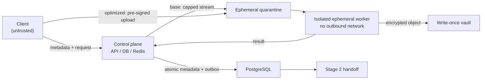
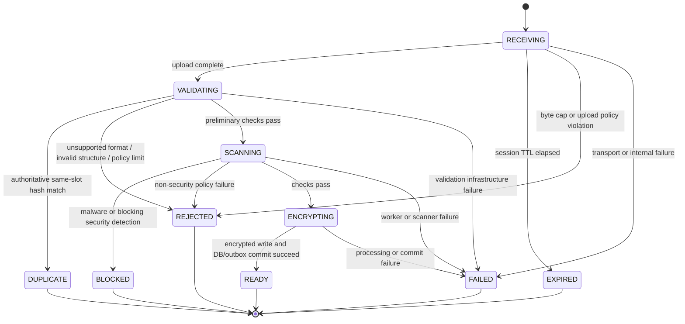

# EGCA Pipeline — Stage 1 Architecture

**Status:** Baseline design; implementation and operational values are not yet
verified against a running system.

## System Goals

- Accept supported uploads while treating the browser, metadata, and file bytes
  as untrusted.
- Keep the API control plane content-blind: it authenticates, authorizes,
  limits, fingerprints, and coordinates, but does not parse file internals.
- Make upload processing idempotent and state transitions deterministic.
- Detect same-slot duplicates using the server-computed SHA-256, with a
  sub-50 ms duplicate response target. This target is not yet measured.
- Inspect hostile files only in an isolated, resource-capped ephemeral worker.
- Persist encrypted content and publish the Stage 2 handoff atomically.

## Non-Goals

Stage 1 does not render documents, perform OCR or text extraction, score
applicants/documents, or make downstream eligibility decisions. It may inspect
structural and security properties and emit advisories for Stage 2.

## Trust Boundaries and Execution Planes

| Plane | Responsibilities | Trust rule |
|---|---|---|
| Client (untrusted) | Fast extension/size feedback, request creation, optional client SHA-256 hint, and (optimized flow) direct upload to quarantine. | Client checks and values are hints only; clients can bypass or alter them. |
| Server control plane | FastAPI authentication/authorization, slot ownership and replacement checks, idempotency, rate limits, upload/session lifecycle, streaming byte cap and authoritative streaming hash (base flow), and atomic metadata/outbox state changes. | Re-validate all security decisions. Do not parse untrusted file internals here. |
| Ephemeral data plane | Isolated quarantine; magic-byte/MIME checks, strict UTF-8 validation where applicable, antivirus, archive/macro checks, PDF probes, authoritative hash verification, and encryption. | Treat files as hostile. Apply CPU, memory, time, filesystem, and network restrictions; destroy temporary data after processing. |
| Permanent storage | Write-once encrypted object vault, metadata, and transactional outbox. | Raw unencrypted files must not be persisted here. |

## End-to-End Lifecycle

The base flow streams the request through the API into ephemeral quarantine.
The optimized flow creates an upload session and pre-signed quarantine URL,
then enqueues processing after storage confirms upload. In either flow, the
worker computes/verifies the authoritative digest, runs applicable checks,
encrypts accepted raw bytes, and asks the control plane to commit metadata and
the `READY` outbox event atomically.

### Terminal states

| State | Meaning | Required cleanup / outcome |
|---|---|---|
| `READY` | All blocking checks passed; encrypted object and metadata/outbox commit succeeded. | Publish versioned handoff; remove quarantine data. |
| `REJECTED` | Unsupported, malformed, or policy-invalid upload that is not classified as a security threat. | Remove quarantine data; return a safe reason code. |
| `BLOCKED` | Antivirus or other blocking security check detected a threat. | Remove normal-path quarantine data; preserve only under an explicitly approved forensic-retention policy. |
| `FAILED` | Infrastructure, worker, encryption, or commit failure prevented a definitive result. | Clean temporary data; allow retry only under idempotency/session rules. |
| `EXPIRED` | Upload session was not completed within its TTL (baseline target: 15 minutes). | Revoke upload capability and remove quarantine data. |
| `DUPLICATE` | Authoritative digest matched an existing document in the same slot. | Remove newly uploaded bytes; do not create a second ready object. |

`REJECTED`, `BLOCKED`, `FAILED`, `EXPIRED`, and `DUPLICATE` are distinct
terminal outcomes and must not be represented as `READY`. Exact persistence,
retry, and forensic-retention semantics remain subject to the open decisions
below.

## Data Contracts

### `Stage1ReadyHandoff` (baseline proposal)

The following is a documentation baseline, not a claim that the schema is
implemented. Additive optional fields may be backward-compatible only if
consumers ignore unknown fields; removing or changing field meaning requires a
contract version bump and coordinated migration.

| Field | Type | Meaning |
|---|---|---|
| `contract_version` | integer (`1` for this baseline) | Schema version consumed by Stage 2. |
| `document_id` | string | Stable Stage 1 document identifier. |
| `slot_id` | string | Authorized destination slot. |
| `sha256` | 64-character hex string | Authoritative digest of uploaded raw bytes. |
| `byte_size` | integer | Authoritative uploaded byte count. |
| `media_type` | string | Detected/normalized media type, not client assertion. |
| `encrypted_object_ref` | string | Opaque reference to ciphertext in the vault; never a raw storage credential. |
| `advisories` | array of advisory objects | Non-blocking observations for Stage 2; must not be interpreted as extraction or scoring results. |
| `created_at` | RFC 3339 timestamp | Time the `READY` handoff was committed. |

An advisory object has `code` (stable machine-readable string), `severity`
(`info`, `warning`, or `high`), and optional non-sensitive `details`. Do not
include document text, secrets, or raw file bytes in the handoff.

### Stage 2 advisories

Potential advisories include PDF password protection, JavaScript or embedded
content indicators, font/structural observations, and format-specific
validation observations. Whether any particular observation blocks Stage 1 or
is advisory-only must be defined by an approved policy; Stage 1 does not extract
text or determine document meaning.

## Open Decisions & Calibration Tracker

| ID | Open decision / metric | Baseline assumption | Evidence needed / exit criterion |
|---|---|---|---|
| O-01 | Accepted formats and precise extension/MIME rules | PDF, DOCX, TXT are intended formats. | Approve format matrix and test valid, malformed, spoofed, and edge-case samples. |
| O-02 | Format-aware byte, page, and character caps | 10 MB is an initial generic byte ceiling; per-format page/character caps are unset. | Configure and measure against an approved representative corpus. |
| O-03 | Blocking versus advisory checks | Malware is `BLOCKED`; several structural findings may be advisory. | Approve rule-by-rule disposition and safe reason/advisory codes. |
| O-04 | Worker resource limits | 512 MB RAM and 10 seconds are illustrative targets; CPU limit is unset. | Benchmark worst-case corpus in the production-like isolation profile. |
| O-05 | Rate-limit quotas | Two tiers are intended (per uploader/minute and per SHA-256/hour); numeric quotas are unset. | Set quotas using load/abuse tests and product requirements. |
| O-06 | Deduplication performance | Sub-50 ms duplicate response is a target. | Demonstrate measured latency at expected database scale and load. |
| O-07 | Session TTL and optimized URL expiry | 15 minutes is the baseline target for both. | Confirm operational retry, cleanup, and storage lifecycle behavior. |
| O-08 | Forensic retention and crypto-shredding | Threat detections may be preserved separately; deletion policy is unresolved. | Approve retention, access, audit, and key-destruction policy. |
| O-09 | Handoff schema and compatibility | `Stage1ReadyHandoff` v1 above is a proposed baseline. | Validate producer/consumer implementation and compatibility tests before release. |
| O-10 | Durable state and retry semantics | Idempotency and atomic `READY` outbox commit are required. | Specify transitions, retry windows, and reconciliation behavior for each terminal state. |

Update this tracker when tests, measurements, or decisions change a baseline.
Move resolved decisions into an ADR and record policy changes in the changelog.
