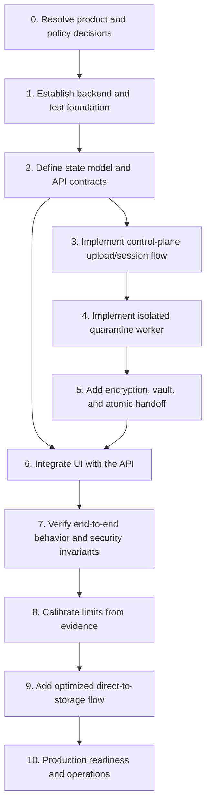

# EGCA Pipeline — Stage 1 Implementation Checklist

This is the ordered delivery plan for taking the current design/UI scaffold to
a production-ready Stage 1 module. Complete each phase's exit criteria before
starting the next dependent phase. Do not treat client-side validation as a
security control.

## Current Snapshot

- [x] Architecture, policy baseline, trust-boundary ADR, and changelog exist.
- [x] Next.js upload UI scaffold and global stylesheet exist.
- [x] UI TypeScript check passes (`pnpm exec tsc --noEmit` in `upload_ui`).
- [x] Minimal FastAPI package, health endpoint, dependency manifest, and initial
  state/schema/API tests exist.
- [ ] Database persistence, upload endpoints, worker, and end-to-end upload
  flow are not yet implemented in the workspace.
- [ ] UI limits (PDF 10 MB, DOCX 5 MB, TXT 512 KB) do not match the policy
  baseline's generic 10 MB cap. Resolve and document before relying on them.
- [x] UI no longer logs raw file bytes/hash and labels local checks `SELECTED`
  rather than server-confirmed `READY`.
- [ ] Browser hashing reads the whole file into memory; keep it optional and
  treat it only as a UX hint when API integration is implemented.

## Delivery Order

## 0. Resolve Product and Policy Decisions

- [ ] Confirm accepted formats and exact extension, detected MIME, and
  structural-validation rules for PDF, DOCX, and TXT.
- [ ] Decide whether to implement the base API-streaming flow first. Recommended
  order: make the base flow reliable before adding direct-to-storage uploads.
- [ ] Choose format-specific byte caps and settle the current UI/policy
  discrepancy. Do not label proposed values calibrated.
- [ ] Decide blocking versus advisory outcomes for each structural/security
  finding, including password-protected PDFs, JavaScript/embedded content,
  macros, malformed documents, and scanner unavailability.
- [ ] Define slot replacement authorization, idempotency/retry semantics, and
  behavior for every terminal state.
- [ ] Decide numeric rate limits, quarantine/session TTL behavior, forensic
  retention, and deletion/crypto-shredding policy.
- [ ] Record resolved architectural choices in ADRs; update
  [ARCHITECTURE.md](ARCHITECTURE.md), [POLICY_AND_LIMITS.md](POLICY_AND_LIMITS.md),
  and [CHANGELOG.md](CHANGELOG.md).

**Exit:** Decisions have owners and explicit values/rules, or remain visibly
marked unresolved in the architecture/policy tracker. No production behavior
depends on an undocumented assumption.

## 1. Establish Backend and Test Foundation

- [x] Scaffold a FastAPI package and health endpoint.
- [ ] Define local development and deployment configuration.
- [ ] Add reproducible dependency locking, environment-based configuration,
  secret handling, formatting/lint/type-check commands, and CI.
- [x] Add an initial test layout for domain state rules, API schemas, and health
  endpoint behavior.
- [ ] Expand tests to cover API/integration, worker, and end-to-end behavior.
- [ ] Add local PostgreSQL and Redis development dependencies/configuration if
  those remain the selected stores.
- [ ] Establish structured logs, correlation/request IDs, health/readiness
  checks, and safe error responses without logging file contents or secrets.

**Exit:** A clean checkout can install dependencies, run the service and its
targeted tests, and CI reports those checks.

## 2. Define State Model and API Contracts

- [ ] Specify upload/session/document records, unique constraints, state
  transitions, timestamps, and safe reason/advisory codes.
- [ ] Specify API request/response contracts for session creation, upload,
  status/result retrieval, and retries.
- [ ] Finalize `Stage1ReadyHandoff`, including required fields, advisory
  structure, and compatibility rules. Keep `contract_version` at `1` unless
  changing the proposed v1 schema; if it changes, document compatibility and
  bump the version before implementation.
- [ ] Define transactional outbox behavior, event idempotency, and recovery
  from a database/storage partial failure.
- [ ] Add schema validation and migration tests.

**Exit:** Contracts and state transitions are agreed, versioned, and covered by
tests before API behavior is built on them.

## 3. Implement the Control-Plane Upload and Session Flow

- [ ] Enforce authentication, authorization, slot ownership, and explicit
  replacement rules server-side.
- [ ] Enforce idempotency keys, session TTL, and concurrency-safe slot
  reservation/state transitions. A repository operation now atomically creates
  `RECEIVING` sessions with an initial audit event and replays matching
  `(principal_id, idempotency_key)` requests; mismatched replays are rejected.
  HTTP integration, TTL policy enforcement, and slot reservation remain open.
- [ ] Enforce configured per-uploader and per-hash rate limits.
- [ ] Stream request bytes into ephemeral quarantine with a hard server-side
  byte cap; do not buffer an unbounded upload in memory. A context-managed
  streaming/quarantine primitive now enforces a caller-supplied byte cap,
  checks the declared size, and computes the authoritative SHA-256; endpoint
  integration and quarantine lifecycle configuration remain outstanding.
- [ ] Compute the authoritative streaming SHA-256 and perform same-slot
  duplicate detection; treat any client hash only as an optimization hint.
- [ ] Keep API handlers content-blind: do not invoke PDF, ZIP, MIME, or antivirus
  parsers in the control plane.
- [ ] Return explicit, stable states/reason codes; never report `READY` before
  successful worker processing and commit.

**Exit:** API tests cover unauthorized requests, occupied slots, retries,
concurrent requests, over-limit streams, duplicates, expiry, and failure
recovery.

## 4. Implement the Isolated Quarantine Worker

- [ ] Run processing in a separate ephemeral container/process with enforced
  CPU, memory, wall-clock, process, and temporary-storage limits.
- [ ] Disable outbound network access and limit filesystem visibility and
  privileges.
- [ ] Verify detected file type/signature against the accepted format policy;
  validate strict UTF-8 for TXT.
- [ ] Inspect DOCX archive metadata without unbounded extraction; enforce
  approved expansion, entry-count, and macro policies.
- [ ] Run antivirus and PDF structural probes under explicit timeouts; define
  scanner/parser error behavior (fail closed or other approved disposition).
- [ ] Emit only stable safe reason codes/advisories; do not extract or return
  document text.
- [ ] Ensure temporary bytes are cleaned on success, rejection, block,
  timeout, crash, and cancellation.

**Exit:** Worker tests demonstrate isolation/resource enforcement and expected
outcomes for valid, malformed, oversized, adversarial, and scanner-error cases.

## 5. Add Encryption, Vault, and Atomic Handoff

- [ ] Integrate KMS-managed envelope encryption and per-document data keys.
- [ ] Store ciphertext only in the permanent write-once vault; keep raw bytes
  only in ephemeral quarantine.
- [ ] Define key lifecycle, access controls, audit trail, deletion, and
  crypto-shredding behavior.
- [ ] Commit metadata and the `READY` outbox event atomically after encrypted
  storage succeeds; make retries/reconciliation idempotent.
- [ ] Verify object cleanup and orphan recovery for failed or partial commits.
- [ ] Publish and validate the versioned `Stage1ReadyHandoff`; include no raw
  content, credentials, or unnecessary sensitive metadata.

**Exit:** Integration tests prove no unencrypted permanent writes and verify
that Stage 2 receives exactly one valid handoff for each `READY` document.

## 6. Integrate the Upload UI with the API

- [ ] Align displayed/client pre-check limits with the approved policy table;
  keep server enforcement authoritative.
- [ ] Remove raw buffer/hash console logging and avoid retaining file bytes
  longer than needed for a UX hint.
- [ ] Replace local-only duplicate tracking with server-authoritative results;
  any client duplicate preflight must remain an optional hint.
- [ ] Use a pre-upload state (for example `SELECTED`/`UPLOADING`) rather than
  presenting local checks as server `READY`.
- [ ] Wire authentication/session creation, upload progress, retry with the
  same idempotency key, and server result/error states.
- [ ] Support accessible file selection, keyboard use, clear validation errors,
  cancellation/reset, and recoverable network errors.
- [ ] Do not send sensitive document content or diagnostic hashes to
  third-party analytics/logging.

**Exit:** UI behavior reflects server state accurately and works for success,
rejection, duplicate, blocked, expired, and retry outcomes.

## 7. Verify End-to-End Behavior and Security Invariants

- [ ] Test all state transitions and assert each terminal state has defined
  persistence, response, cleanup, and retry behavior.
- [ ] Test malicious-client cases: bypassed UI checks, forged metadata/hash,
  spoofed extensions/MIME, unauthorized slot access, replayed keys, and
  concurrent uploads/replacements.
- [ ] Test size boundaries, empty files, partial uploads, duplicate races,
  worker timeout/crash, storage failure, and outbox recovery.
- [ ] Test that the control plane never parses file internals and workers cannot
  reach external networks or access unrelated files/secrets.
- [ ] Test quarantine deletion and verify raw uploads are not present in
  permanent storage, logs, traces, or error reports.
- [ ] Run formatter, linter, type checks, unit/integration tests, and a
  production build; record results in CI.

**Exit:** All required suites pass and each architecture invariant has a
repeatable test or deployment verification.

## 8. Calibrate Limits from Evidence

- [ ] Create/version a representative and legally approved corpus for each
  accepted format, including boundary and malformed samples.
- [ ] Benchmark parser/antivirus latency, CPU, peak memory, temporary storage,
  and timeout behavior in the production-like worker profile.
- [ ] Load-test rate limits, duplicate lookup latency, and concurrent upload
  capacity at expected database scale.
- [ ] Set and document format byte/page/character limits, worker quotas,
  timeouts, rate quotas, and cleanup TTLs based on observed evidence.
- [ ] Update each policy row with dataset version, sample count, environment,
  measured result, date, and report reference; only then mark it
  **Calibrated (Measured)**.

**Exit:** Every production threshold is enforced and evidence-backed; remaining
unmeasured assumptions are explicitly risk-accepted.

## 9. Add the Optimized Direct-to-Storage Flow

- [ ] Design session creation and pre-signed quarantine upload constraints:
  object key, method, byte cap, content length/checksum policy, and short TTL.
- [ ] Ensure client-provided hashes never bypass worker-side authoritative
  hashing, validation, or deduplication.
- [ ] Trigger jobs from verified storage completion and make queue delivery and
  worker processing idempotent.
- [ ] Add quarantine object expiry/lifecycle cleanup for abandoned or
  unprocessable uploads.
- [ ] Re-run the end-to-end security, concurrency, cleanup, and limit suites
  against the optimized path.

**Exit:** Optimized and base flows converge on the same authorization,
validation, state, encryption, and handoff guarantees.

## 10. Production Readiness and Operations

- [ ] Complete threat model, security review, dependency/image scanning, and
  secrets/access-control review.
- [ ] Define dashboards and alerts for upload outcomes, queue age, worker
  resource use, scanner health, failures, duplicate latency, and cleanup
  backlog without exposing file content.
- [ ] Write operator runbooks for scanner outage, worker saturation, stuck
  sessions, object-store failure, key rotation, incident response, and
  quarantine cleanup.
- [ ] Verify backups, disaster recovery, retention/deletion controls, audit
  logging, and least-privilege production identities.
- [ ] Deploy through staging with representative traffic; run smoke tests and
  verify rollback/recovery.
- [ ] Obtain explicit production sign-off for unresolved risks and policy
  deviations.

**Exit:** Staging evidence, operational ownership, incident procedures, and
release approval are in place.

## Change Tracking

For each completed implementation task, update [CHANGELOG.md](CHANGELOG.md).
Update architecture, policy, and ADRs when behavior, thresholds, or decisions
change. Any Stage 2 handoff schema change must include a `contract_version`
compatibility assessment.
